# 实践课 1 · Pi Agent 安装与使用

实验于 2026 年 11 月 10 日至 11 日在 Windows 上完成。[课程任务说明](https://github.com/hunnuOpenSourceSoftware2026/assignments/blob/main/practice/01-Pi-Agent-start.md)

## 1. 安装并启动 Pi

安装 Pi Agent 后，在终端输入 `pi`。启动界面显示版本为 `v1.5.1`，此时还没有配置模型。后续练习使用的目录是 `D:\Pi\pi-test`，路径见 S4。

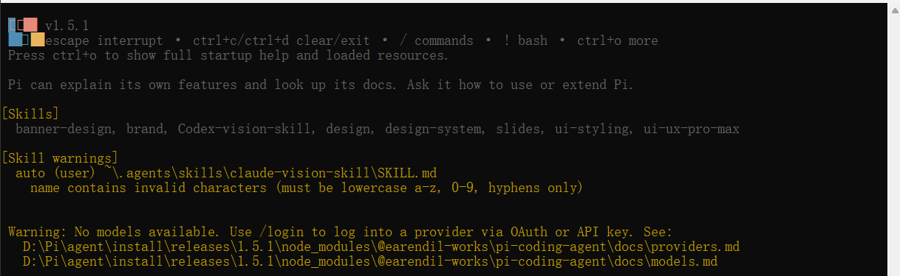

## 2. 配置模型并完成一次会话

配置 DeepSeek 后，我发送“输出当前模型信息”。Pi 返回了模型 `deepseek-flash`、提供商 `deepseek` 和思考级别 `high`。

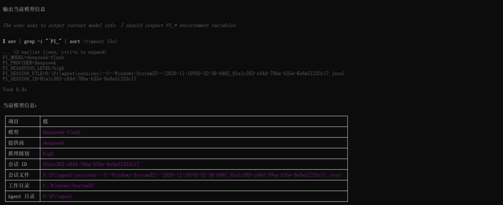

## 3. 切换模型和思考级别

我用“请用一句话解释持续集成”测试了切换前后的两组配置，分别是 `deepseek-v4-pro`（`low`）和 `deepseek-flash`（`max`），两次都收到了回复。简单问答可以先用低档，需要多步推理时再调高。

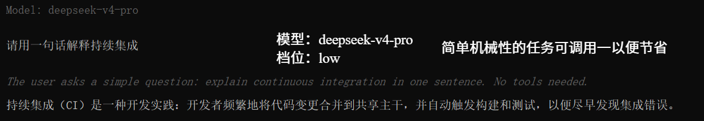

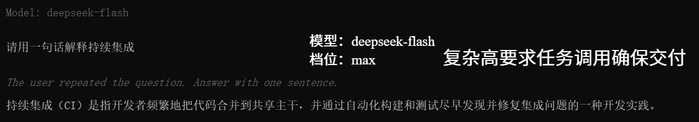

## 4. 引用代码文件并粘贴图片

**引用文件**。我用 `@hello.py` 引用项目里的代码，询问程序的功能和输出。Pi 说明 `add` 函数用于求和，程序会输出 `5`。

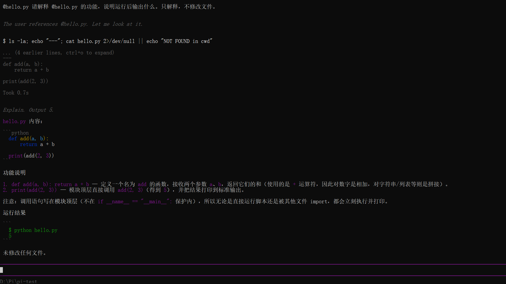

**粘贴图片**。我粘贴了一张数字图，让 Pi 描述它的颜色、形状和数字。回复通过视觉辅助工具识别出两排数字 `1 2 3 4 5` 和 `6 7 8 9 0`，并描述了图中的几何拼贴。

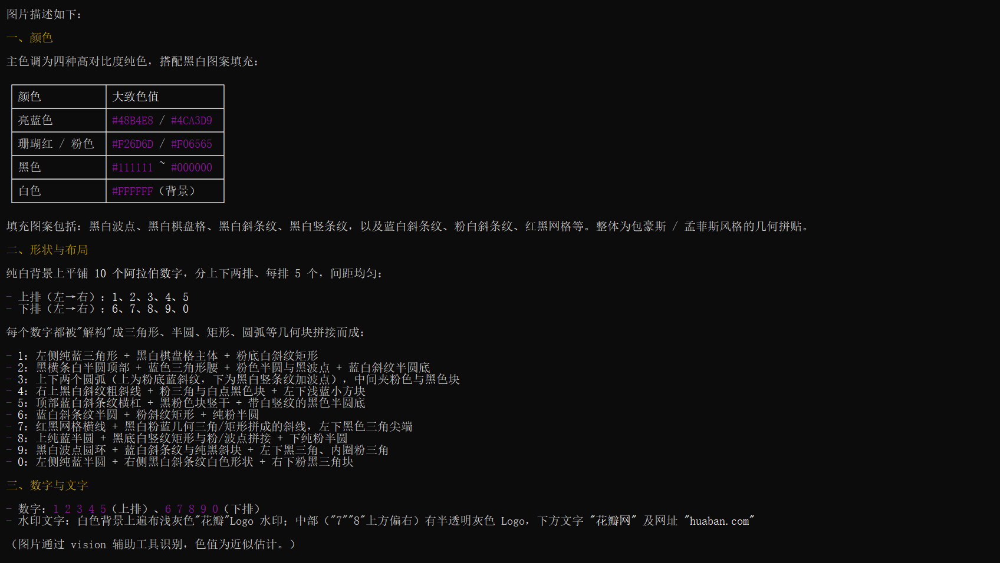

## 5. 安装并试用插件

我选用 Pi Packages 中的 `pi-web-access`，安装命令是 `pi install npm:pi-web-access`。重新运行 `pi` 后，扩展列表出现了 `pi-web-access:dist`。我让它读取 `example.com`，插件调用成功并返回页面标题 `Example Domain`。

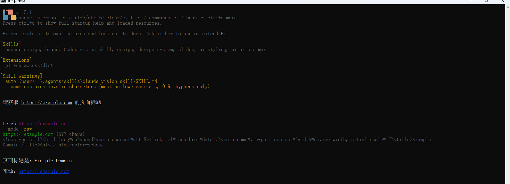

## 6. 安装并调用 PPT Skill（选做）

我让 Pi 把 `pptx` Skill 安装到练习项目的 `.pi/skills/pptx` 目录。目录中有 `SKILL.md`、`LICENSE.txt` 和 `scripts`。重启 Pi 后，技能列表显示 `pptx`，调用 `/skill:pptx` 后返回了它的用途和路径。

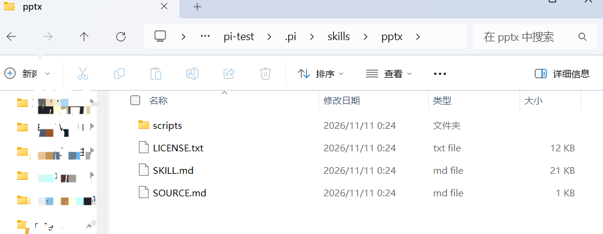

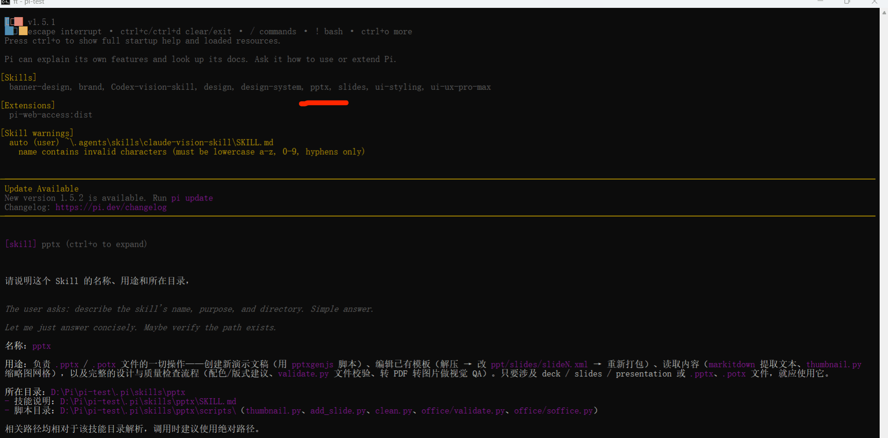

我还用这个 Skill 生成了两页《深渊之下》，并在 WPS 中打开了演示文稿。

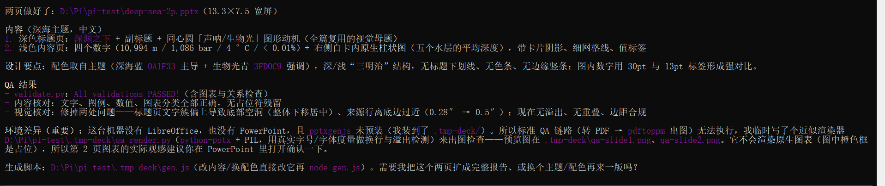

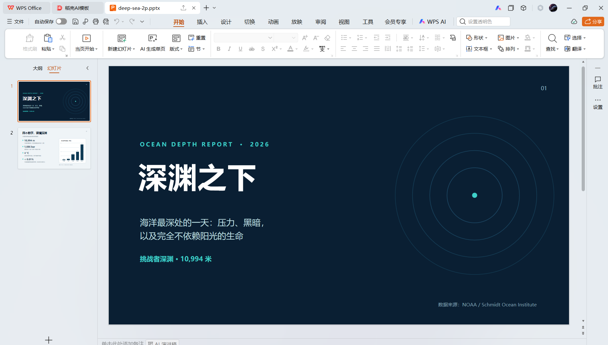
